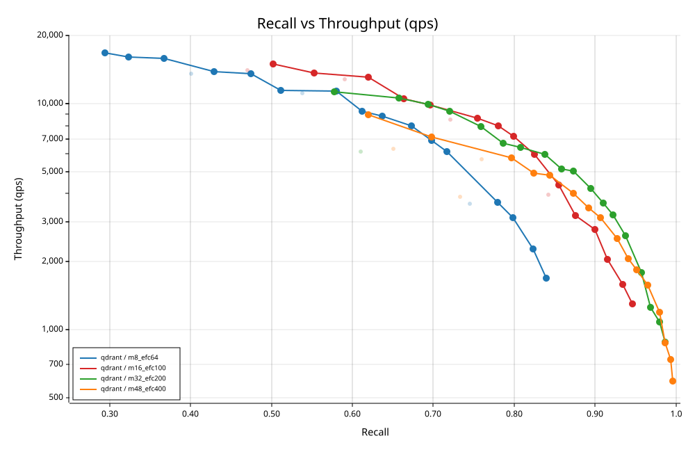

# Jingra - Vector Search Benchmarking Framework

A Rust benchmarking framework for vector search engines, currently focused on Qdrant. The
engine abstraction (`BenchmarkEngine`) is written to add more engines later without touching
the config/data/evaluation/CLI layers.

## Supported Engines

- **Qdrant** - Vector search with binary quantization
- More engines coming soon

## Install

jingra is distributed as source. Download a release from the
[GitHub releases page](https://github.com/sachinfrayne/jingra/releases) (or `git clone` the
repository) and build it yourself. No binaries or Docker images are published.

```bash
make build            # or: cargo build --release
target/release/jingra --version
```

The version is the `version` field in `Cargo.toml` (currently 0.1.0), shown by
`jingra --version` and in the startup banner. Changes between versions are listed in
[CHANGELOG.md](CHANGELOG.md).

## Quick Start

**Prerequisites:** Rust (see `rust-toolchain.toml` -- `rustup` installs the pinned version automatically), Docker (for integration tests)

```bash
# Build
make build   # same as: cargo build --release

# Load data
target/release/jingra load config.yaml

# Run the benchmark sweep
target/release/jingra bench config.yaml

# Generate CSV + recall/latency plots from stored results
target/release/jingra report config.yaml
```

## Example result

Recall vs throughput on GloVe-100 (1.18M vectors), sweeping Qdrant's HNSW build parameters
(`m`, `ef_construct`) and the query-time `hnsw_ef`, produced by `jingra report`. Each line is one
build's Pareto frontier. See [benchmarks/glove-100-hnsw](benchmarks/glove-100-hnsw/) for the
setup, caveats and how to reproduce it.



## Configuration

Configuration is YAML-based. Connection credentials are read from environment variables at runtime.

```yaml
engine: "qdrant"

qdrant:
  url_env: "QDRANT_URL"
  vector_field: "embedding"

dataset: "my-dataset"

datasets:
  my-dataset:
    type: "vector"
    index_name: "my_index"
    schema_name: "my_schema"
    query_name: "my_query"
    path:
      data_path: "datasets/data.parquet"
      queries_path: "datasets/queries.parquet"
    data_mapping:
      id_field: "id"
    queries_mapping:
      query_vector_field: "embedding"
      ground_truth_field: "ground_truth"
    param_groups:
      recall@100:
        - {size: 100, hnsw_ef: 128}

load:
  threads: 4               # concurrent ingest requests (default 10)
  batch_size: 1000         # documents per request (default 1000)
  queue_capacity: 8        # batches buffered in memory (default 8)
  await_index_ready: true  # wait for the engine to finish background indexing
  index_ready_timeout_seconds: 14400
  max_retries: 10          # per batch, transient errors only (default 10)
  recreate_existing_index: true   # false: fail instead of dropping an existing index

evaluation:
  warmup_workers: 16
  measurement_workers: 16
  warmup_rounds: 3
  measurement_rounds: 1

logging:
  level: INFO              # also: DEBUG, WARN, ERROR
  loggers:
    "jingra::engine": DEBUG   # optional per-module overrides

output:
  # Any object_store-supported URI: file://, s3://, gs://, az://. Local by default, so `bench`
  # run as a Kubernetes Job still leaves results somewhere durable once the pod is gone.
  results_uri: "file://./results"
  per_query_metrics: true

report:
  run_id: "my-run"
  engines: ["qdrant"]
  results_uri: "file://./results"
  output_directory: "./report-output"
  generate_plots: true
```

### What `load` does to an existing index

`load` starts from an empty index: if `index_name` already exists it is **deleted and recreated**.
That is what a benchmark needs, but on a shared cluster set `load.recreate_existing_index: false`
and `load` will refuse (and delete nothing) instead. The data file is located and read before the
engine is touched, so a mistyped `data_path` never costs you an existing index.

Ingest batches are retried only for transient failures (timeouts, dropped connections), up to
`load.max_retries` times with backoff. Permanent errors, such as a vector of the wrong dimension
or a bad API key, fail the load immediately. Keep `batch_size` and `queue_capacity` modest for
high-dimensional vectors: each queued batch is held in memory (roughly 32 bytes per vector
component).

### Results location

`output.results_uri` and `report.results_uri` accept `file://` paths (absolute, or relative to
the working directory such as `file://./results`), `s3://`, `gs://` and `az://` locations.
Running `bench` again with the same `run_id` adds results next to the old ones; `report` uses
the most recent result for each parameter set and says so in its log.

### Secure connections

Use an `https://` URL in `QDRANT_URL` for TLS. Certificates are checked against the system
trust store, so a private CA must be trusted at the OS level or via `SSL_CERT_FILE`. Skipping
certificate verification (for self-signed certificates) is not supported.

See [demos/](demos/) for complete worked examples (config, schema/query templates, and a
Docker Compose harness that spins up a real Qdrant container).

## Docker

```bash
# Build image locally (images are not published)
make docker-build   # same as: docker build -t jingra:local .

# Run
docker run --rm \
  --user "$(id -u):$(id -g)" \
  -e QDRANT_URL \
  -v "$PWD/config.yaml:/config/jingra.yaml:ro" \
  -v "$PWD/datasets:/app/datasets:ro" \
  -v "$PWD/results:/app/results" \
  jingra:local bench /config/jingra.yaml
```

## Development

### Agent Instructions

Project rules for AI assistants live in `AGENTS.md`. After cloning, create symlinks:

```bash
ln -sf AGENTS.md CLAUDE.md
ln -sf ../../AGENTS.md .cursor/rules/jingra-project.mdc
```

### Testing

```bash
# Run all tests (requires Docker, or podman with DOCKER_HOST pointed at its API socket)
make test

# Run a specific test
cargo test metrics::

# Coverage report
make coverage
```

`make test`/`make coverage` enforce a coverage floor via `cargo llvm-cov` -- see `AGENTS.md` for
why it's a ratchet on the codebase's actual achieved coverage rather than a hardcoded 100%.

### Adding an Engine

1. Implement the `BenchmarkEngine` trait in `src/engine/`
2. Register it in `engine::create_engine()`
3. Add schema/query templates in `jingra-config/schemas/` and `jingra-config/queries/`

### Adding a Results Sink

1. Implement the `ResultsSink` trait in `src/output/`
2. Wire it up wherever sinks are constructed (currently `cli::bench`)

## Competitive Benchmarking Studies

Large-scale competitive benchmarks (Terraform, Kubernetes, multi-engine comparisons) live in a separate benchmarking studies repository, not here. This repo is the Jingra CLI/library you build locally or package as a container.

## License

[Apache 2.0](LICENSE)
