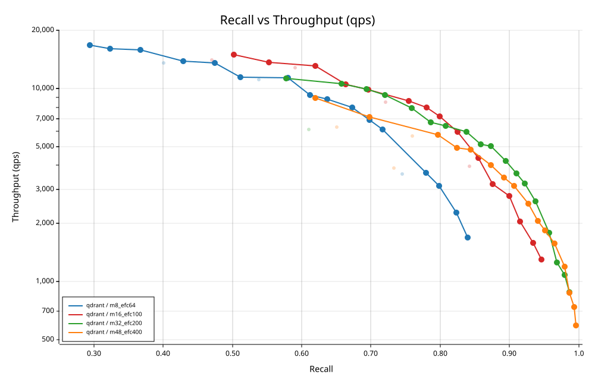

# GloVe-100 HNSW parameter sweep

A recall vs throughput Pareto benchmark of Qdrant, produced end to end by jingra
(`load`, `bench`, `report`). It sweeps both HNSW build parameters (`m`, `ef_construct`) and the
query-time parameter (`hnsw_ef`) on a real dataset.



Each line is one HNSW build configuration; each point is one `hnsw_ef` value (10 to 1024). The
bold line is that build's Pareto frontier (points no other point of the same build beats on
both recall and throughput); faint dots are measurements the frontier dominates. The throughput
axis is logarithmic. Up and to the right is better. The latency view is
[`results/recall_vs_latency_p99.svg`](results/recall_vs_latency_p99.svg) and the raw numbers are in
[`results/comparison.csv`](results/comparison.csv).

## Setup

| | |
|---|---|
| Dataset | [`glove-100-angular`](http://ann-benchmarks.com/glove-100-angular.hdf5) from ann-benchmarks: 1,183,514 vectors, 100 dimensions, cosine |
| Queries | The dataset's 10,000 test queries, scored as recall@10 against its precomputed exact neighbors |
| Engine | Qdrant 1.18.0 (`engine-versions/.qdrant`), default settings apart from the HNSW parameters under test |
| Builds | `m` / `ef_construct` of 8/64, 16/100 (Qdrant's defaults), 32/200, 48/400 |
| Query sweep | `hnsw_ef` in 10, 12, 16, 20, 24, 32, 40, 48, 64, 80, 96, 128, 160, 192, 256, 384, 512, 768, 1024 |
| Load | 4 concurrent clients, batches of 1000, waits for the optimizer to finish indexing before benchmarking |
| Client | `jingra` and Qdrant as containers on one Docker Compose network (the `run.sh` flow below) |
| Measurement | 4 concurrent workers, 1 warmup round, then 3 measured rounds (30,000 queries per point) |

## Results

| Build (m / ef_construct) | Max recall@10 | QPS at max recall | Best QPS at recall >= 0.90 | Best QPS at recall >= 0.95 | Index time |
|---|---|---|---|---|---|
| 8 / 64 | 0.840 | 1685 | n/a | n/a | 1.3 min |
| 16 / 100 | 0.946 | 1295 | 2777 | n/a | 2.7 min |
| 32 / 200 | 0.986 | 881 | 3635 | 1783 | 5.2 min |
| 48 / 400 | 0.996 | 592 | 3138 | 1837 | 13.3 min |

Index time is ingest plus waiting for the optimizer to finish, for 1.18M vectors.

**What the data supports.** Larger graphs reach a higher recall ceiling (0.84, 0.95, 0.99, 1.00)
at the cost of longer indexing and more memory, and only the 48/400 build gets past 0.99. At
low recall the smaller graphs are faster (the 16/100 build leads below about 0.65). The 8/64
build is the slowest at every recall of 0.75 and above, where it can reach them at all.

**What it does not support.** Between about 0.7 and 0.97 the 16/100, 32/200 and 48/400 builds
are close, and their order is not a finding. This sweep was run twice with the same
configuration: at recall 0.90 the 48/400 build was 12% faster than 32/200 in the first run
(3690 vs 3282 QPS) and 14% slower in this one (3138 vs 3635). Treat differences of around 15%
between neighbouring builds as noise. A bigger graph buys recall at the high end, not speed.

## Caveats, read before quoting a number

- **Not a hardware benchmark.** Qdrant and the jingra client ran as containers in a 4 vCPU,
  10 GiB Podman VM on a laptop, competing for the same CPUs. Absolute QPS and latency will differ
  on real server hardware, and with the client on a separate machine. The shapes and the
  recall ceilings are the meaningful part.
- **Single run, visible noise.** Each point averages 30,000 queries, but this graph is one run
  of the sweep. Repeating it moved individual points by 10 to 15%, which is why several
  measurements sit below the frontier and why close builds cannot be ranked.
- **The highest throughput may still be client-limited.** The client and Qdrant share the same
  four CPUs, and the benchmark client uses four concurrent workers over one gRPC connection.
  The highest values (about 17,000 QPS at low recall) were not checked against a faster client,
  so read them as a floor on what Qdrant can serve here, not a measurement of it.
- Recall is recall@10 against exact neighbors, not an ann-benchmarks run, so do not place these
  numbers beside ann-benchmarks charts without noting that the client, concurrency and hardware
  differ.

## Reproduce

Everything runs in Docker. The only things needed on your machine are **Docker with Compose v2**
(`docker compose`) and an internet connection. No Rust, Python or Qdrant install.

```bash
git clone https://github.com/sachinfrayne/jingra && cd jingra
benchmarks/glove-100-hnsw/run.sh quick     # one build, 8 hnsw_ef values: a few minutes
benchmarks/glove-100-hnsw/run.sh           # the full sweep shown above: about 40 minutes
```

Results appear in `benchmarks/glove-100-hnsw/work/report/` (`recall_vs_throughput.svg`, latency
plots and `comparison.csv`). The first run also builds two images (jingra, compiled from source
inside Docker, and a small Python image for data preparation) and downloads the 485 MB dataset,
which is cached in `work/` for later runs.

What the script starts: a pinned Qdrant container (the version in `engine-versions/.qdrant`), a
one-shot `prepare` container (downloads GloVe-100 from ann-benchmarks, converts it to Parquet with
exact ground truth, generates the jingra configs) and a `bench` container (`jingra load`, `bench`
and `report` for each build). Containers and networks are removed afterwards; `work/` and the
built images stay so a rerun is fast.

| Environment variable | Default | Meaning |
|---|---|---|
| `BUILDS` | `8:64,16:100,32:200,48:400` | HNSW `m:ef_construct` build configurations to compare |
| `EF` | 19 values, 10 to 1024 | query-time `hnsw_ef` values to sweep |
| `WORKERS` | `4` | concurrent query workers |
| `WARMUP_ROUNDS` / `MEASUREMENT_ROUNDS` | `1` / `3` | passes over the 10,000 queries per point |

For example `BUILDS=16:100,64:512 EF=32,128,512 benchmarks/glove-100-hnsw/run.sh`.

**Resources.** Tested with Docker's VM at 4 CPUs and 10 GiB of memory; allow about 3 GB of disk.
Qdrant and the client compete for CPU, so close other heavy workloads while it runs, and expect
different absolute numbers than the graph above on different hardware.

If you only have the standalone `docker-compose` binary, run
`COMPOSE=docker-compose benchmarks/glove-100-hnsw/run.sh`.

**Troubleshooting.**
- *Data preparation hangs or crashes with exit code 139.* The Python image is probably running
  under CPU emulation (x86 image on an ARM Docker host). Check with
  `docker image inspect python:3.12-slim --format '{{.Architecture}}'` and, on ARM hosts, run with
  `DOCKER_DEFAULT_PLATFORM=linux/arm64`.
- *Qdrant is killed or `load` fails part-way.* Docker's VM is out of memory; give it 8 GiB or more.
- *A different dataset URL.* Set `DATASET_URL` to mirror the HDF5 file; the downloader verifies
  the size against the server's `Content-Length`.
